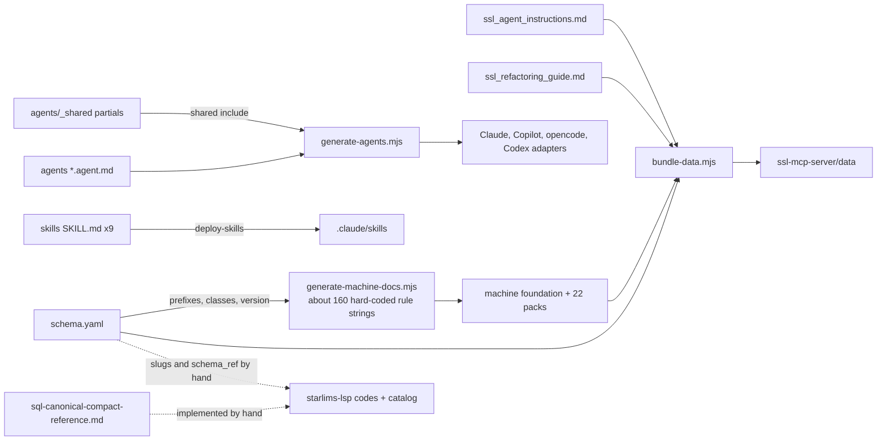

# Design: one rules source

**Status:** Adopted 2026-10-13. Implemented in #111–#117 (phases 1–5); see `rules/README.md` for how to work with it.
**Issue:** #101 (follows the #91 decision that rule text moves into one source; epic #93)
**Scope:** phase 1 of #101 — record format, layout, generator and checks, piloted on data sources.

## 1. Goals and non-goals

**Goals**

- Every SSL language and style rule is written **once**, as one record in `rules/`.
- Every rule-bearing artifact is generated from those records and checked in CI
  with `--check`, as the agent adapters and machine packs are today. That covers
  the schema's rule entries, the machine packs and `foundation.md`, the skills'
  rule blocks, the agent partials, and the rule sections of the guides.
- Record examples are executable. Good examples validate clean. Bad examples
  trigger the diagnostic or formatter change named in `enforced_by`, and each
  `enforced_by` resolves to a starlims-lsp catalog entry.
- Consumers keep working unchanged: the schema's path, keys and lint slugs, the
  MCP tools and resources, and the LSP's `schema_ref` paths.

**Non-goals**

- Changing what any rule says. Extraction is a refactor, and content fixes
  land in their own PRs (§8).
- Generating the grammars (EBNF, tree-sitter, TextMate) or the vendored element
  data. Records point at elements; they do not restate them.
- Generating the starlims-lsp catalog, or being generated from it (§7).
- Replacing narrative, tutorial or worked-example prose. Renaming the repo (D9).

## 2. Where rules live today

| Source | Lines | Rule-bearing content | Reaches consumers through |
|---|---|---|---|
| `ssl-style-guide/ssl-style-guide.schema.yaml` | 1,870 | levels, lint slugs, messages, config values | MCP mirror, `generate-machine-docs`, LSP by convention |
| `agent-guides/ssl_agent_instructions.md` | 1,837 | quick start, hard rules, §4A, §7 do/don't, §8 gotchas | MCP mirror; agents read it directly |
| `ssl-style-guide/sql-canonical-compact-reference.md` | 1,434 | §1 rules table, layout examples | read directly; the formatter implements it |
| `agent-guides/ssl_refactoring_guide.md` | 974 | layout order, checklists | MCP mirror |
| `ssl-style-guide/ssl-ebnf-grammar.md` | 439 | grammar notes | MCP mirror (stays hand-written) |
| `agent-guides/ssl_server_script_style.md` | 274 | server-script baseline | read directly; **not** in the MCP mirror |
| `agent-guides/skills/*/SKILL.md` (9) | 1,475 | "core rules" bullet blocks | `deploy-skills.mjs` copies them as-is |
| `agent-guides/agents/_shared/*.md` | 223 | quality bar, sources of truth | `{{shared:name}}` in `generate-agents.mjs` |
| `tools/generate-machine-docs.mjs` | — | 130 `mustFollow`/`avoid` strings in 22 `CATEGORY_DEFS`, plus about 30 foundation bullets | generated packs, MCP mirror |



Every edge that carries a rule *statement* is a hand copy. Two disagreements
found while surveying for this document:

- **Data-source defaults.** The inline-default rule is stated about 20 times in
  12 files. The schema says `default_required: false` (settled in #48), but the
  `ssl-new-datasource` skill still says "Every parameter MUST have a default".
- **SQL `CASE` indentation.** The compact reference (§1, §5) and the formatter
  put `WHEN`/`ELSE` 4 spaces under `CASE`. The schema
  (`sql.formatting.indentation.sub_clauses.case_when_else: 2` and
  `statement_patterns.case.when_else`) and `ssl_agent_instructions.md` say 2.

## 3. The rule record

One file per rule, `rules/<domain>/<id>.md`: strict YAML frontmatter and then
fixed Markdown headings. The format mirrors the starlims-lsp catalog entry.

| Field | Req. | Meaning |
|---|---|---|
| `id` | yes | Globally unique `snake_case` slug, equal to the filename. Reuses an existing schema or LSP slug verbatim (D3). |
| `title` | yes | Short human title. |
| `domain` | yes | `language`, `server-scripts`, `data-sources`, `sql`, `classes`, `naming`. Must match the directory. |
| `status` | yes | `draft`, `active`, `deprecated` or `removed`. A `removed` record keeps its history and is never generated into guidance. |
| `level` | yes | `authoritative`, `style_only` or `advisory`: the schema's vocabulary (D4). |
| `severity` | yes | `error`, `warning`, `info` or `hint`: how a reviewer treats a violation. Compared with the LSP's `default_severity` (§6). |
| `applies_to` | yes | One or more of `server_script`, `class`, `ssl_data_source`, `sql_data_source`, `embedded_sql`. |
| `rule` | yes | The one-line, imperative statement. Includes and packs emit this text. |
| `categories` | yes | Machine-pack ids (the current 22 `CATEGORY_DEFS` ids). |
| `machine` | no | `list: must_follow` or `list: avoid`, plus an optional `foundation: non_negotiable` or `foundation: does_not_have`. |
| `related_elements` | no | Element ids from `ssl-element-reference.json` (for example `RunDS`, `strict-equals`). |
| `enforced_by` | yes | `lsp:diag.<slug>`, `lsp:fmt.<slug>`, `reviewer`, or `none`. |
| `schema` | no | Placements in the generated schema: `path`, and a `form` of `lint` (`{rule, severity, message}`), `rule_text` (`{level, rule}`) or `value`. An optional `message` overrides `rule`. |
| `verification` | yes | `basis` (`reference`, `observed` or `convention`) and a `note` saying what was checked and when. |
| `issues`, `aliases` | no | Issues that changed or dispute the rule; earlier ids that still resolve. |

**Body:** `## Rationale` (required), `## Exceptions` (optional), and
`## Examples` with `### Good` and `### Bad` subsections (required when
`active`). `## Notes` is optional and never generated.

**Fence info strings:** `ssl` validates as a script and `ssl kind=ds` as a data
source. A `sql` fence is wrapped in `SQLExecute("...")` for the format check.
`text` is illustration only.

### Example: data-source rule

````markdown
---
id: no_default_statements_in_datasource
title: Data sources take defaults inline, not from :DEFAULT
domain: data-sources
status: active
level: authoritative
severity: error
applies_to: [ssl_data_source, sql_data_source]
rule: >-
  In a data source file, give a parameter its default inline in :PARAMETERS
  with := and never write a separate :DEFAULT statement.
categories: [data-sources]
machine: { list: must_follow, foundation: non_negotiable }
related_elements: [PARAMETERS, DEFAULT, RunDS]
enforced_by: [lsp:diag.no_default_statements_in_datasource]
schema:
  - path: module_structure.data_source_modules.lint_rules
    form: lint
    message: >-
      Data source files use inline := defaults in :PARAMETERS, not separate
      :DEFAULT statements.
verification:
  basis: reference
  note: >-
    Inline defaults are rewritten to :PARAMETERS plus :DEFAULT before the data
    source runs, and stay optional per parameter (#48). The pilot re-confirms
    that a hand-written :DEFAULT is an error rather than only redundant.
issues: ["#48", "#82"]
---

## Rationale

Data source files are preprocessed before they run. The builder rewrites each
inline `:=` default into a `:DEFAULT` statement itself, so the script layout of
`:PARAMETERS` followed by `:DEFAULT` does not apply to data source files.

## Exceptions

A parameter with no default is valid. Ordinary scripts still use `:DEFAULT`.

## Examples

### Good

```ssl kind=ds
:PARAMETERS sStatus := "Logged", sTestCode;
:RETURN SQLExecute("SELECT ordno FROM ordtask WHERE status = ?sStatus? AND testcode = ?sTestCode?");
```

### Bad

```ssl kind=ds
:PARAMETERS sStatus, nDays;
:DEFAULT sStatus, "Logged";
:RETURN SQLExecute("SELECT ordno FROM ordtask WHERE status = ?sStatus?");
```
````

### Example: SQL layout rule

````markdown
---
id: sql_and_or_indent
title: AND/OR continue 2 spaces under their clause
domain: sql
status: active
level: style_only
severity: info
applies_to: [embedded_sql, sql_data_source]
rule: >-
  In multi-line SQL, start each AND/OR on its own line, indented 2 spaces
  under its WHERE clause. In a join condition, AND aligns with ON.
categories: [sql, formatting]
machine: { list: must_follow }
related_elements: [SQLExecute, RunSQL]
enforced_by: [lsp:fmt.sql_in_strings]
schema:
  - { path: sql.formatting.indentation.sub_clauses.and_or, form: value, value: 2 }
  - { path: sql.formatting.statement_patterns.where.and_or, form: value, value: indented 2 under WHERE }
verification:
  basis: convention
  note: Canonical compact reference §1. Matches formatter output at LSP v0.24.0.
---

## Rationale

Major clauses sit at column 0 of the SQL block, so a 2-space step sets each
condition off from the next clause without spending a full indent level.

## Examples

### Good

```ssl
:DECLARE sStatus, aRows;
sStatus := "Logged";
aRows := SQLExecute("
    SELECT ordno, testcode
    FROM ordtask
    WHERE status = ?sStatus?
      AND testcode = 'PH'
");
```

### Bad

```ssl
:DECLARE sStatus, aRows;
sStatus := "Logged";
aRows := SQLExecute("
    SELECT ordno, testcode
    FROM ordtask
    WHERE status = ?sStatus?
    AND testcode = 'PH'
");
```
````

### Example: language rule

````markdown
---
id: equals_vs_strict_equals
title: Use == for exact string comparison
domain: language
status: active
level: advisory
severity: info
applies_to: [server_script, class, ssl_data_source]
rule: >-
  Use == when strings must match exactly. On strings, = is a prefix match:
  it is .T. when the right side is empty or the left side starts with it.
categories: [operators, strings]
machine: { list: must_follow, foundation: non_negotiable }
related_elements: [equals, strict-equals, not-equals]
enforced_by: [lsp:diag.equals_vs_strict_equals]
schema:
  - path: lints.type_safety
    form: lint
    message: >-   # current schema text, kept verbatim during extraction
      For strings, = is loose equality (returns .T. if right is empty or if
      left starts with right) while == does exact matching. != negates ==
      (strict), not = (loose), so = and != are not logical opposites for
      strings. For other types, both delegate to the same comparison. Prefer
      == for string comparisons where exact match is needed.
verification:
  basis: reference
  note: Operator behavior as documented for = and == in the element reference.
---

## Rationale

The prefix match surprises authors from other languages, and `!=` is not its
opposite, because `!=` negates `==`.

## Exceptions

A deliberate prefix test may use `=`. Say so in a comment.

## Examples

### Good

```ssl
:DECLARE sStatus, bDone;
sStatus := "Complete";
bDone := sStatus == "Complete";
```

### Bad

```ssl
:DECLARE sStatus, bDone;
sStatus := "Complete";
bDone := sStatus = "Complete";
```
````

All six example fences were run through the pinned LSP (v0.24.0) under the
strict profile. Every good fence validates clean. The bad fences produce
`no_default_statements_in_datasource` and `equals_vs_strict_equals`. The
formatter rewrites the bad SQL fence to the good layout and leaves the good
fence unchanged.

## 4. Layout

**Option A: YAML per domain** (`rules/data-sources.yaml`). A whole domain is
visible at a glance, in few files. But SSL examples with tabs, quotes and `;`
are fragile in YAML block scalars, reviews land in one large file, and the
LSP catalog's fence conventions do not carry over.

**Option B: Markdown per rule** (`rules/<domain>/<id>.md`). Examples are
ordinary fences that render on GitHub. Each rule gets its own review thread and
history, and new rules never conflict. It has the same shape as starlims-lsp's
`catalog/diagnostics/*.md`, so the loader, fences and review habits carry
over. The cost is roughly 200–300 small files and no single-file view of a
domain.

**Recommendation: B.** A generated `rules/INDEX.md` gives the overview, with
one table per domain (id, level, severity, rule, enforced_by). Pack metadata
that is not a rule (labels, aliases, summaries, element lists) moves to
`rules/categories.yaml`.

## 5. Relationship to the schema

These consumers read the schema today, and all of them must keep working:

| Consumer | What it reads |
|---|---|
| MCP `ssl_style_rule` | Top-level keys via `TOPIC_KEYS`: `comments`, `naming`, `formatting`, `files`, `keywords`, `blocks`, `expressions`, `error_handling`, `sql`, `classes`, `object_oriented`, `procedures`, `control_flow`, `declarations`, `array_operations`, `string_literals`, `database_integration_patterns`, `security_best_practices`, `performance_guidelines`, `lints`, `function_calls`, `property_method_access`, `dynamic_code_execution`, `special_literals`, `regions`, `module_structure`, `language_features`, `editor_support`, `formatter_hints`, `examples`, `documentation` |
| MCP resources | `ssl://style-guide` (whole file), `ssl://style-guide/{section}` (any top-level key) |
| MCP indices | `procedures.function_categories`, `lints.hungarian_notation.prefixes` |
| MCP prompts | `ssl_code_review` and `ssl_refactoring` read `naming`, `formatting`, `error_handling`, `sql`, `security_best_practices`, `lints`, `classes`, `control_flow`, `procedures` |
| `check-consistency.mjs` | Byte equality with the MCP mirror, and `object_oriented.object_creation.builtin_classes.all_classes` (29 classes) |
| `generate-machine-docs.mjs` | `metadata.version`, `metadata.last_updated`, Hungarian prefixes, built-in classes |
| starlims-lsp | Does **not** load the schema. It mirrors it by hand: diagnostic codes are the schema's lint slugs verbatim; 41 of 129 diagnostic entries carry a `schema_ref` dotted path (for example `lints.compile_errors.doproc_in_class`); and the type table in `expr_types.go` copies `lints.hungarian_notation.prefixes` |
| vs-code-ssl-formatter | Diagnostic constant names follow the schema's lint slugs |

**Option 1: the schema becomes the source.** It is restructured so that each
rule is a record inside it. This needs no new directory and is closest to the
literal #91 decision. But it either breaks every path above or forces records
into the schema's irregular shapes (`{rule, message}` lists in some places,
value maps in others). It also keeps examples in YAML, and mixes configuration
data (keyword lists, SQL clause lists, function categories) with rule prose.

**Option 2: the schema is generated.** `rules/schema-base.yaml` holds
everything that is not a rule record: `metadata`, keyword and operator tables,
SQL clause lists, function categories, Hungarian prefixes. The generator adds
each record's `schema` placements and writes
`ssl-style-guide/ssl-style-guide.schema.yaml` at the same path, with the same
keys and a "generated, do not edit" header. Every consumer and `schema_ref`
keeps resolving, and data flows one way. The cost is one more generator, and
no direct edits to the schema.

**Recommendation: Option 2.** It refines #91 from "rule text goes in the
schema" to "rule text reaches the schema". The schema stays the stable,
tool-agnostic interface, and `rules/` is where the text is authored. The pilot
generates only the `module_structure.data_source_modules` subtree, splices it
into the otherwise hand-maintained schema, and requires that the parsed result
is deep-equal to the current file before switching. Phase 2 moves the rest to
`schema-base.yaml`. A change to the generated schema still bumps
`metadata.version`, and the machine docs are regenerated.

## 6. Generation targets, include markers and checks

There is one new tool, `tools/generate-rules.mjs`, with `--check` for CI. It
loads and validates every record and plans these outputs:

| Target | How |
|---|---|
| `ssl-style-guide.schema.yaml` | `schema-base.yaml` plus the records' `schema` placements (§5) |
| `agent-guides/machine/categories/*.json` | `must_follow`/`avoid` from records by `categories` and `machine.list`. `CATEGORY_DEFS` loses its rule strings. |
| `agent-guides/machine/foundation.md` | Non-Negotiable and Does Not Have lists from `machine.foundation`. The retrieval-protocol prose stays a template. |
| Skills, guides, SQL reference, `_shared` partials | In-place generated regions (below). `{{shared:…}}` keeps working unchanged. |
| `rules/INDEX.md` | Per-domain tables |
| `ssl-mcp-server/data/rules.json` | All active records, compiled. Mirrored by `bundle-data.mjs` and checked by `check-consistency.mjs`. |

**Include markers.** Skills and guides are published as written, because
`deploy-skills.mjs` and `bundle-data.mjs` copy them byte for byte. So they use
**in-place regions**, which the generator rewrites and `--check` compares:

```text
<!-- rules: category=data-sources applies_to=sql_data_source format=bullets -->
- …generated lines…
<!-- /rules -->
<!-- rule: no_default_statements_in_datasource -->…generated line…<!-- /rule -->
```

Selectors are `id=`, `category=`, `domain=`, `level=` and `applies_to=`.
Formats are `bullets` (the `rule` text, the default), `table` (rule, level,
severity) and `full` (rule, rationale and the good example). Files with a
separate generated output, which today means only `*.agent.md`, may also use
line includes `{{rule:<id>}}` and `{{rules:<selector>}}`. These expand like
`{{shared:…}}`.

**CI checks**, added to `.github/workflows/ci.yml`:

1. **Record lint.** Frontmatter is strict, so an unknown field fails. `id` is
   unique and matches the filename, and `domain` matches the directory.
   `categories` exist in `categories.yaml`, `related_elements` exist in the
   vendored element reference, and `active` records have their required
   sections.
2. **Drift.** `generate-rules.mjs --check` fails on any differing generated
   file or region, or on a stale output. The existing `--check` steps and
   `check-consistency` keep running.
3. **Examples.** These run after `fetch-lsp` with the same binary and strict
   profile, by extending `check-skill-examples.mjs`. Every good fence validates
   with no errors or warnings, and `ssl` good fences are formatter-stable. For
   `lsp:diag.X`, every bad fence must produce `X` and no good fence may. For
   `lsp:fmt.X`, formatting a bad fence must change it. `kind=ds` fences skip
   the format step, as they do now.
4. **`enforced_by` resolves.** CI shallow-clones the public starlims-lsp repo
   at the tag pinned in `ssl-mcp-server/lsp-version.json`. Each `lsp:diag.<slug>`
   or `lsp:fmt.<slug>` must have an `active` entry under `catalog/`. A record's
   `severity` is compared with the entry's `default_severity`: a warning in the
   pilot, a failure from phase 5. Every non-null catalog `schema_ref` must
   resolve in the generated schema or name a `removed` record.
5. **Orphan restatements** (from phase 3). A report-only grep finds the `rule`
   text of `machine.foundation` records outside generated regions.

## 7. Relationship to the LSP catalog

The catalogs answer different questions. They reference each other by slug,
and neither generates the other.

- **`rules/`** says what the rule is, why it holds, and what correct and
  incorrect SSL look like. Every consumer needs this, including agents, guides,
  the schema, reviewers and the LSP.
- **The LSP catalog** says what the tool does about a rule: ranges,
  false-positive guards, configuration, suppression and history. Its README
  already says its entries never restate a language rule; they point back with
  `schema_ref`.
- **Links.** Rule to tool is `enforced_by`. Tool to rule is `schema_ref`, which
  keeps working under Option 2. Phase 5 proposes an optional
  `rule_ref: <id>` to starlims-lsp. Its frontmatter is strict, so that needs an
  LSP PR.
- **Coverage.** Of the schema's 33 lint slugs, four have no LSP entry:
  `no_flag_builder_directives`, `numeric_type`, `underscore_private_convention`
  and `variable_lookup_order`. Their records say `reviewer` or `none`. Of the
  88 diagnostic entries with `schema_ref: null`, most are tool behavior; any
  that encode a language rule should get a record here in phases 2–5.
- **Examples** are short canonical illustrations. Catalog fences encode the
  false-positive history. They may overlap, but neither copies the other.
- **Stale cross-reference found:** the LSP entry for
  `no_default_statements_in_datasource` still lists #48 as an open question,
  but #48 is closed. The pilot's verification note (§3) settles it, and the LSP
  entry is updated to match.

## 8. Migration phases

**Pilot: data sources.** This is the smallest domain, and it has the most live
disagreement (#82).

1. Land the generator, the record lint, and the example and `enforced_by`
   checks, with no records yet.
2. Write the data-source records, about 12–15 of them: inline and optional
   defaults; no empty `:PARAMETERS;`; no `:DEFAULT`; `@name` placeholders and
   undeclared placeholders; SQL comments in SQL data sources and SSL comments in
   SSL ones; builder directives; the body follows `:PARAMETERS`; `RunDS` binds
   by position; one kind per file.
3. Generate from them: the `data_source_modules` subtree (deep-equal check
   first), the `data-sources` pack lists, the foundation's data-source bullet,
   the `ssl-new-datasource` rule block, and the §4A rule list in
   `ssl_agent_instructions.md`.
4. Report record count, lines removed and drift fixed. Decide go or no-go.

**Phase 2: generator strings and schema rules.** Move the 22 categories'
strings, the foundation lists, and every schema lint and rule-text entry into
records, one domain per PR. Move the rest of the schema to `schema-base.yaml`.

**Phase 3: skills.** Each skill's "core rules" block becomes a region.

**Phase 4: guides and partials.** Rule lists and tables become regions inside
the hand-written narrative: the quick start, §7 and rule-like §8 items of
`ssl_agent_instructions.md`, the refactoring checklists, the server-script
baseline, the SQL reference's §1 table, and the `_shared` quality bar.

**Phase 5: consumers.** Add an MCP `ssl_rule` tool that looks up by id,
category or `applies_to`, and keep `ssl_style_rule`. Severity mismatches fail
CI. Propose `rule_ref` to starlims-lsp.

**Open issues and PRs.** Extraction must not hide content changes. When copies
disagree, a record cites the copy it kept, and the PR lists the variants it
dropped.

| Item | Interaction | Recommendation |
|---|---|---|
| PR #100 (inherited surfaces) | Not merged yet; edits skills and the schema | Merge before the pilot |
| PR #94 (re-vendor element data) | `related_elements` validates against the inventory | Merge before the pilot |
| PR #96 (language claims, #88) | Prose and schema edits across the language domain | Merge first; phase 2 extracts from the merged text |
| #82 (data sources and SQL) | Its data-source items are the pilot's lines | Fix them **in the pilot**, as a commit before the extraction commit. The SQL argument-slot and `RETURNING` items land as plain fixes. |
| #80, #81, #83, #84, #86 | Language, classes, types and scope content | Fix before that domain is extracted: one place, not five copies |
| #85 (EBNF) | The EBNF stays hand-written | Independent |
| #98 (agent tuning) | Its guide contradictions are rule drift. The reviewer severity rubric maps onto the record `severity` field. | Fix the contradictions as content PRs now. Define the rubric in terms of record severity so that phase 3 can generate it. |
| `CASE` indentation and data-source defaults (§2) | New, found here | File them as content issues; fix before or during their domain's extraction |

## 9. Open decisions

| # | Decision | Options | Recommended |
|---|---|---|---|
| D1 | Schema relationship | becomes the source / generated from `rules/` | **Generated**, same path and keys, from `rules/` plus `schema-base.yaml` (§5) |
| D2 | File format | YAML per domain / Markdown per rule | **Markdown per rule** with strict frontmatter, plus a generated `INDEX.md` |
| D3 | Id scheme | `domain.kebab-name` / global `snake_case` | **Global `snake_case`**, reusing schema lint slugs and LSP codes verbatim |
| D4 | Level vocabulary | `authoritative/style/advisory` / the schema's `authoritative/style_only/advisory` | **Keep `style_only`**. No mapping layer is needed, and LSP `authority` values already match. |
| D5 | Include syntax in published files | `{{rule:id}}` with a build step / in-place comment regions | **In-place regions** for skills, guides and partials. `{{rule:…}}` only in `*.agent.md`. |
| D6 | LSP catalog relationship | one generates the other / cross-reference by slug | **Cross-reference**: `enforced_by` here, `schema_ref` (later `rule_ref`) there |
| D7 | Content fixes vs extraction | fold into extraction / land first | **Land first**, except the #82 data-source items, which go in the pilot as a separate commit |
| D8 | How much of `ssl_agent_instructions.md` is generated | all rules / rule lists only | **Rule lists and tables only**: the quick start, §4A takeaways, §5 style, §7, rule-like §8 items and the SQL quick reference, roughly 15–25% of the file. The overview, type-system explanation, worked examples and function reference stay hand-written. |
| D9 | Repo rename | with the restructure / separately | **Separately, after phase 2.** A rename touches MCP configs, CI sibling paths and the LSP's sibling drift test, and should not be mixed with a content migration. |
| D10 | LSP catalog source in CI | shallow clone at the pinned tag / an LSP release asset | **Shallow clone** now. Ask for a catalog-index release asset later if the clone becomes a burden. |
| D11 | Severity disagreement with the LSP | fail / warn | **Warn in the pilot, fail from phase 5**, once the existing mismatches are triaged |
